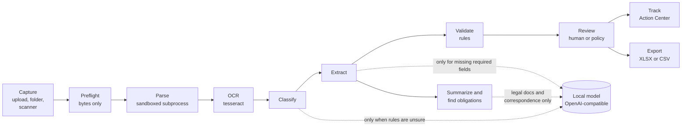

# VaultAI

Local document AI for business. Private documents, verified action.

VaultAI turns a pile of business paperwork (checks, receipts, invoices, contracts, purchase orders, policies, memos, forms) into verified records, a review queue, a deadline list, and an auditable Excel export. Everything runs on one machine. The target device is an ASUS Ascent GX10 (NVIDIA DGX Spark) running a local Nemotron model. No document, page image, or extracted value is ever sent to a cloud API.

The working rule is to automate the routine, surface the risky, and keep the human in control. Clean receipts can be approved by policy. Anything with a warning (a total that does not add up, a missing signature, an auto-renewal clause, hidden text, text that tries to instruct an AI) stops in the review queue until a person decides.

This is a hackathon entry for the ASUS Local AI Track. It is an MVP, not a production system. The recommended demo target is an ASUS Ascent GX10 running vLLM with NVIDIA Nemotron 3.5 Lightning; the repeatable demo command is in [docs/DEMO.md](docs/DEMO.md). See [Known limitations](#known-limitations) and [SECURITY.md](SECURITY.md) before you trust it with real paperwork.

## What it does

| Step | What happens |
| --- | --- |
| Capture | Drop files or a folder (PDF, PNG, JPEG, HEIC, TIFF, or plain text), or feed pages from a scanner. Bundled fictional samples cover every document type. |
| Preflight | Byte-level checks before anything is stored. Spoofed files, encrypted or active PDFs, decompression bombs, and duplicates are refused. |
| Parse | A sandboxed subprocess renders pages and reads the text layer. Pages without text go to tesseract OCR, up to four pages at once. |
| Classify and extract | Rules pick the document type and read the fields for that type. A local model is asked only for what the rules could not read, and every model value must cite and quote a line of the document. |
| Validate | Deterministic rules check arithmetic, dates, identifiers, signatures, duplicates, contract clauses, and prompt injection. |
| Review | Each document lands in `approved`, `ready`, or `needs_review`. A reviewer corrects fields, approves, rejects, or defers. The AI value is kept beside every human edit. |
| Track | Obligations with due dates feed the Action Center and the dashboard. |
| Export | Approved records go to an XLSX workbook or CSV on this device. No cell is ever a formula. |

## Architecture



Processes on the machine:

| Process | Binds to | Purpose |
| --- | --- | --- |
| Desktop API and built frontend | `127.0.0.1:8765` | FastAPI app. Serves `/api/*` and, when `frontend/dist` exists, the React UI. Refuses requests whose `Host` header is not local and state changes without the `X-VaultAI: 1` header. |
| Phone listener (optional) | `<lan-ip>:8766` | A separate FastAPI app with three routes. Rejects any client that is not on a loopback, private, or link-local address. Disabled in the GX10 demo profile. |
| Parser worker | none | `python -I vaultai/parsing/worker.py`, one subprocess per document, with CPU and file-size limits, a 60 s timeout, and an address-space cap on Linux. |
| tesseract | none | Runs as a subprocess on the PNG the parser produced, never on the uploaded bytes. |
| Local model server | `127.0.0.1:8000` | vLLM serving `nvidia/NVIDIA-Nemotron-3.5-Lightning-30B-A3B-NVFP4`. VaultAI talks to it over HTTP with proxies disabled. A public hostname is refused at startup. |

Data lives under `data/` (configurable with `VAULTAI_DATA_DIR`), created with owner-only permissions. The SQLite database is `data/vaultai.db`. Raw files, rendered pages, capture pages, and exports are in separate subdirectories with server-generated names.

## Repository layout

```
.env.example            recommended GX10/Nemotron demo profile and all VAULTAI_* settings
backend/
  vaultai/              the Python package (API, pipeline, model adapters, export, capture)
  tests/                pytest suite (core/ for the pipeline, surfaces/ for the API)
  requirements.txt      runtime dependencies
  requirements-dev.txt  runtime plus pytest
docs/
  API.md                HTTP contract, generated TypeScript types mirror it
  DEMO.md               click-by-click demo script
  AI_TUNING_BASELINE.md model-path metrics before the tuning work
  AI_TUNING.md          what changed, final metrics, fine-tuning decision, how to reproduce
frontend/
  src/                  React 19 + TypeScript app (Vite)
  dist/                 production build, served by the backend when present
samples/
  demo/                 13 fictional documents loaded by Import & Scan > Demo samples
  scanner/              3 documents the mock scanner feeds page by page
  adversarial/          5 files that preflight must reject or deduplicate
  expected.json         ground truth for every sample
scripts/
  eval_samples.py       scores the pipeline against expected.json (mock, oracle, or local model; text, OCR, or stress)
  gen_types.py          regenerates frontend/src/api/types.ts from domain.py
  start_gx10_demo.sh     verifies Nemotron, builds the UI, starts VaultAI, and loads samples
SECURITY.md             security model, threat model, retention, known gaps
```

## Setup

You need Python 3.11 or newer, Node.js (24.14 was used here), and tesseract. SANE is optional and only for a physical scanner.

Install the system tools.

On the GX10 or any Ubuntu machine:

```sh
sudo apt install tesseract-ocr
sudo apt install sane-utils      # only if you will attach a scanner
```

On macOS:

```sh
brew install tesseract
```

Install the Python and Node dependencies and create your configuration:

```sh
python3 -m venv backend/.venv
backend/.venv/bin/pip install -r backend/requirements-dev.txt
cd frontend && npm install && cd ..
cp .env.example .env
```

`.env` is read from the repository root at startup. The checked-in example is the recommended GX10/Nemotron demo profile: it uses the local OpenAI-compatible endpoint, local OCR, and disables phone pairing. The `mock` backend remains available for deterministic tests, but is not the track demo configuration. Set `VAULTAI_ENV_FILE` to read a different file.

## Run

For the local-AI-track demo, start the GX10's local Nemotron server first and verify that it advertises the expected model:

```sh
curl -fsS http://127.0.0.1:8000/v1/models
```

Then use the one-command workflow. It verifies the model endpoint, builds the frontend if needed, starts the backend, waits for the health endpoint, and optionally imports the 13 bundled samples:

```sh
./scripts/start_gx10_demo.sh --load-samples
```

Open http://127.0.0.1:8765. Use `./scripts/start_gx10_demo.sh --stop` to stop the background backend.

For a manual start, the backend creates the data directory and database if they are missing.

```sh
cd backend && .venv/bin/python -m vaultai
```

For development with hot reload, start the Vite server in a second terminal and open http://127.0.0.1:5173. Vite proxies `/api` to the backend on 8765 and rewrites the `Host` header to `127.0.0.1:8765`, which the API requires. The API does not accept the dev server's own host.

```sh
cd frontend && npm run dev
```

For production mode, build the frontend once. The backend then serves the UI itself at http://127.0.0.1:8765.

```sh
cd frontend && npm run build
```

Stop the backend with Ctrl-C. Both ports and the host are settings (`VAULTAI_HOST`, `VAULTAI_PORT`). `VAULTAI_HOST` must be a loopback or private address, or startup fails.

### Initialize the database

Startup does this automatically. To do it without starting the server:

```sh
cd backend && .venv/bin/python -m vaultai init-db
```

The command prints the data directory it prepared.

### Load the sample documents

In the UI, open **Import & Scan**, choose the **Demo samples** tab, and click **Import sample folder**. Then click the **Process** button above the queue.

From the shell, this imports and processes the same 13 files without the UI:

```sh
cd backend && .venv/bin/python -m vaultai load-samples
```

Running it twice is safe. The second run reports `0 new sample documents (13 already present)` because preflight deduplicates by SHA-256.

## Local model configuration

VaultAI ships with two model backends. Set `VAULTAI_MODEL_BACKEND` in `.env`.

| Backend | What it is |
| --- | --- |
| `mock` | Test-only deterministic rules backend. No language model is contacted; useful for repeatable unit tests and sample evaluation. |
| `openai_compat` | Recommended for the GX10 demo. VaultAI calls the local vLLM OpenAI-compatible server running NVIDIA Nemotron 3.5 Lightning. The adapter also supports other local `/v1` servers such as NVIDIA NIM, TensorRT-LLM, llama.cpp, and Ollama. |

Settings for `openai_compat`:

```sh
VAULTAI_MODEL_BACKEND=openai_compat
VAULTAI_MODEL_ENDPOINT=http://127.0.0.1:8000/v1
VAULTAI_MODEL_NAME=nvidia/NVIDIA-Nemotron-3.5-Lightning-30B-A3B-NVFP4
VAULTAI_MODEL_API_KEY=            # only if your local server needs one
VAULTAI_MODEL_CONTEXT_TOKENS=8192
VAULTAI_MODEL_MAX_TOKENS=1024
VAULTAI_MODEL_TIMEOUT_S=180
VAULTAI_MODEL_TEMPERATURE=0
VAULTAI_MODEL_JSON_MODE=true      # false sends no response_format at all
VAULTAI_MODEL_RESPONSE_FORMAT=json_schema   # json_schema | json_object | none
VAULTAI_MODEL_VISION=false        # Nemotron 3.5 Lightning is text-only; local OCR handles page images
VAULTAI_MODEL_ENABLE_THINKING=false  # sent as chat_template_kwargs.enable_thinking on every request
VAULTAI_MODEL_SYSTEM_PREFIX=      # see below
VAULTAI_MODEL_CONCURRENCY=2       # model requests in flight at once, across all documents
VAULTAI_MODEL_EXTRACT_CONTEXT_CHARS=2400    # document text per field-extraction request
VAULTAI_MODEL_ANALYSIS_CONTEXT_CHARS=12000  # document text per obligation/summary request
```

What the model is asked to do, and what it is not allowed to do:

- The rules classify every document first. The model is asked to classify only when the rules are unsure (confidence below 0.6 or a small margin between the top two types). It sees the opening of page 1, the top of later pages, and the rules' closest candidates.
- The model is asked to extract only the required fields the rules missed or read with confidence below `VAULTAI_REVIEW_CONFIDENCE_THRESHOLD` (0.75). It is never asked for signature status, because a text-only model cannot see a signature. It sees the lines most likely to hold those fields, up to `VAULTAI_MODEL_EXTRACT_CONTEXT_CHARS`, so a short document goes whole and a long one does not.
- Only contracts, agreement letters, statements of work, policies, correspondence, and "other" documents get a model summary and obligation pass. Checks, receipts, invoices, purchase orders, quotes, and forms get a template summary of their verified fields and no model call. Analysis chunks run concurrently, up to `VAULTAI_MODEL_CONCURRENCY` requests at once.
- Each document type has its own prompt template (`backend/vaultai/model/templates.py`). Each template names the type, the allowed keys, required and optional fields, value types, what each field is and is easily confused with, and the null rule. Legal templates allow facts and issue spotting only, keep the document's wording, and leave risk flags to the rules.
- The model sees each line's id and exact text, with layout notes on separate lines: pages, tables and their columns, clauses, signature blocks, two-column blocks read one column at a time, and low OCR confidence. Page numbers and repeated headers and footers are left out.
- Output is constrained with a per-task JSON Schema (`response_format: json_schema`). If the server refuses schemas, VaultAI uses `json_object` instead. A reply that is not JSON or not the schema gets one repair turn, two attempts in all. A reply is read up to 1 MB.
- Every value must name a line id the model was shown and quote that line exactly (spacing aside). Text values are stored as printed. Amounts, dates, and currencies are re-parsed from the quote. Values that fail are discarded and logged as `ungrounded_value`, and are never retried. Output that still does not match the schema is discarded whole as `model_output_rejected`.
- Confidence comes from the evidence, not from the model:
  - label proximity, OCR quality, and agreement with the rules;
  - cross-field arithmetic, date order, and identifier checks;
  - a ceiling of 0.85, and anything below 0.40 is discarded.

  `docs/AI_TUNING.md` has the full policy. A model value never replaces a more confident rules value.
- Model output never auto-approves, whatever the thresholds. Auto-approval requires the rules-only route and every required field to come from the rules or a human edit. A document whose fields, summary, or obligations came from the model is model-assisted.
- Lines flagged as hidden or as prompt injection are never sent to the model.
- There is no code path from model output to a status change, an approval, a deletion, or a file. The model adapter only returns JSON.

Endpoint and failure rules:

- The endpoint host must be `localhost` or a loopback, RFC 1918, link-local, or IPv6 ULA address. Anything else fails at startup with `ConfigError`. The check runs again before every request.
- Proxy environment variables are ignored (`trust_env=False`), redirects are not followed, and the in-process egress guard blocks any socket connect to a non-local address.
- If the model is unreachable, times out (`VAULTAI_MODEL_TIMEOUT_S`), or answers with an error, the document keeps its rules-only results, gets a `model_unavailable` warning, and goes to `needs_review`. There is no fallback to a cloud API and no silent fallback to the mock backend.
- Validated model answers are cached in the database. The key covers the document hash, the exact prompt, the prompt version, the model, and the model settings, so changing any of them asks again.
- Per-document stage timings, model calls, retries, rejections, token counts, and rejection reasons are stored in `doc_metrics` without any document text. Reasons are stable codes with counts; the rejected reply, the prompt, and quoted lines are never stored or logged. Totals appear on the dashboard and at `GET /api/system/metrics`.
- **Settings & Privacy** shows whether the endpoint is reachable and which model it serves.

Every request carries a top-level `"chat_template_kwargs": {"enable_thinking": false}` (from `VAULTAI_MODEL_ENABLE_THINKING`, false by default). With vLLM's reasoning parser on, Nemotron 3.5 Lightning otherwise spends its tokens on a `reasoning` field and returns `content: null`. VaultAI reads only `message.content`. Reasoning text is never taken as an answer, and an empty reply counts as unusable: it gets the one repair attempt, then the document goes to review with `model_output_rejected`. If a model writes `<think>` blocks inside `content`, the reply parser strips them before it looks for the JSON object.

`VAULTAI_MODEL_SYSTEM_PREFIX` is prepended as the first line of the system prompt on every request. Some reasoning models accept `/no_think` there. Nemotron does not need it once thinking is off in the chat template.

`VAULTAI_MODEL_VISION=true` enables one more use. When a page has no text layer and no OCR engine is available, the page image is sent to the model for transcription. A document read this way takes the vision route, so it can never auto-approve. When tesseract is installed, OCR is used and the vision path is not.

## Supported document types

Every type has a fixed field schema in `backend/vaultai/schemas.py`. The table lists the required fields and the main optional ones. Legal types (contract, agreement letter, statement of work, policy) always carry an issue-spotting disclaimer, and putting one in `VAULTAI_AUTO_APPROVE_TYPES` fails at startup.

| Type | Required fields | Also extracted |
| --- | --- | --- |
| Check | payee, amount, check date, check number | payer, bank, written amount, routing and account numbers, memo, signature present |
| Receipt | merchant, date, total | address, receipt number, subtotal, tax, payment method, line items |
| Invoice | vendor, invoice number, invoice date, total | address, due date, bill to, PO number, terms, subtotal, discount, tax, line items |
| Purchase order | PO number, buyer, vendor, order date, total | delivery date, ship to, terms, subtotal, tax, line items |
| Proposal / quote | vendor, date, total | quote number, client, valid until, subtotal, tax, line items |
| Contract | title, parties, effective date, signature status | expiration, auto-renewal, renewal terms, notice period and deadline, termination, payment terms, value, governing law, dispute resolution, signatories, clauses, obligations |
| Agreement letter | sender, recipient, letter date, acceptance status | organizations, subject, agreement statement, effective date, compensation, terms, acceptance deadline, termination, obligations |
| Statement of work | title, client, provider, effective date | end date, total fees, payment terms, signature status, dated deliverables |
| Business policy | title, effective date | policy number, version, owner, next review, numbered rules as obligations |
| Administrative form | form title | form number, submitted by, date, signature present |
| Correspondence | from, date | to, subject, deadlines as obligations |
| Other | none | title, date, organization, amount, reference |

Every document also gets the generic key-value pairs the rules find, full-text search over its visible text, and a currency field.

Validation rules, from `backend/vaultai/validation/rules.py`:

- Required field missing, low extraction confidence, low OCR confidence, no readable text.
- Dates that are not real calendar dates, or a due date before an issue date.
- Line items that do not add to the subtotal, totals that do not equal subtotal minus discount plus tax, tax that does not match a printed rate, more than one currency.
- Checks whose written amount or MICR line disagrees with the printed values, routing numbers that fail the ABA checksum.
- Amounts above `VAULTAI_UNUSUAL_AMOUNT` on checks and receipts, or more than three times the counterparty's usual total on other types.
- Probable duplicates of a document already in VaultAI, by counterparty plus identifier (or merchant, date, and total for receipts).
- Missing or partial signatures.
- Contract clauses that auto-renew, cap no one's liability, indemnify one way, restrict competing or hiring, let only one party terminate for convenience, or rely on undefined standards such as "commercially reasonable efforts".
- Hidden text, prompt injection, and model values that contain links, paths, or commands.

## Review policy

`decide()` in `backend/vaultai/pipeline/process.py` holds the whole policy:

1. Any warning or error issue, including injection and hidden text, sends the document to `needs_review`.
2. A required field that is missing or below `VAULTAI_REVIEW_CONFIDENCE_THRESHOLD` (0.75) sends it to `needs_review`.
3. If the type is in `VAULTAI_AUTO_APPROVE_TYPES` (default `receipt`), the document took the rules-only route, every required field came from the rules or a human, and every required field has confidence of at least `VAULTAI_AUTO_APPROVE_MIN_CONFIDENCE` (0.9), the document is `approved` with approval kind `policy`, and an `auto_approve` audit row records the rule that applied.
4. Otherwise the document is `ready` for one-click human approval.

Set `VAULTAI_AUTO_APPROVE_TYPES=` (empty) to review everything. A legal type in that list is refused at startup with `ConfigError`. The same checks (local model endpoint, local host, no legal auto-approval) run whenever a `Settings` object is built, not only when `.env` is read.

Review actions follow the status table in `backend/vaultai/domain.py`. **Approve**, **Reject**, and **Defer** are allowed from `ready` or `needs_review`. **Reopen** is allowed from `approved`, `exported`, or `rejected`. Anything else returns 409 with "Not allowed while the document is <status>." Field edits are accepted in `ready`, `needs_review`, `approved`, `exported`, and `rejected`. Approving a document that still has error-level issues requires a reviewer note. Editing an approved or exported record moves it back to `needs_review`.

## Scanner setup

VaultAI drives SANE scanners through `scanimage`. Install `sane-utils`, confirm `scanimage -L` lists your device, and leave `VAULTAI_SCANNER_BACKEND=auto`. Open **Import & Scan**, choose the **Scanner** tab, pick the device, set resolution, color, and duplex, and click **Scan page** for each page. Rotate, crop, reorder, or retake pages, give the document a title and optional type, then assemble it. The pages become one PDF and enter the normal intake path.

Without SANE, `auto` falls back to the mock scanner, which feeds the three PDFs in `samples/scanner/` page by page with a slight skew and speckle. Set `VAULTAI_SCANNER_BACKEND=none` to hide the tab. Use your operating system's scan utility and drop the resulting PDF on the **Files** tab if you prefer.

The SANE path was not tested on real hardware during this hackathon. The mock scanner was tested end to end, including OCR of a two-page capture with tesseract 5.5.3.

## Phone capture

Phone capture is off by default. To enable it, set `VAULTAI_PHONE_ENABLED=true` in `.env` and restart. VaultAI then opens a second listener on the LAN address it puts in the QR code, port 8766 (`VAULTAI_PHONE_PORT`). It binds only that address and refuses to start if the address is not private, loopback, or link-local. Set `VAULTAI_PHONE_HOST` to the LAN IP you want in the QR code if auto-detection picks the wrong interface. Set `VAULTAI_PHONE_ENABLED=false` and restart to disable it again.

Pairing workflow:

1. Open **Import & Scan**, choose the **Phone** tab, and click the start button. The desktop shows a QR code, a URL, and a 6-digit code.
2. Scan the QR code with the phone. The phone must be on the same local network. The page shows the same 6-digit code. Confirm they match.
3. Take photos. Rotate or crop each page on the phone. Click **Send pages to VaultAI**.
4. The desktop polls the session, imports the assembled PDF with source `phone`, and the Import queue updates.

The link carries a 32-byte random token in the URL fragment, which the browser never sends to a server. The phone sends the token in the `X-Pairing-Token` header. The server stores only its SHA-256, compares in constant time, and the session is single use with a 10-minute expiry (`VAULTAI_PHONE_SESSION_TTL_S`). An unknown, used, expired, or cancelled session returns 404 on every route. EXIF data, including GPS, is dropped when the page is re-encoded. Photos are limited to 20 pages of 12 MB each. The listener is plain HTTP on the LAN. See [SECURITY.md](SECURITY.md) for what that means.

Photos already on an iPhone do not need the listener. AirDrop them to the Mac and drop the HEIC files on **Import & Scan** > **Files & folders**. They take the same path as JPEG photos. Unlike phone capture, the original file is kept as sent, including any location data it carries.

## Local-only privacy guarantees

What the code guarantees, and how:

- The desktop API binds to `127.0.0.1` by default and refuses any other `VAULTAI_HOST` that is not loopback or private. Requests whose `Host` header is not the local address get 421, which stops DNS rebinding. State-changing requests without the `X-VaultAI: 1` header get 403, which stops cross-site form posts. No CORS is enabled.
- The egress guard (`VAULTAI_EGRESS_GUARD=true`) patches `socket.connect` and `socket.connect_ex` for the whole process so a connection to any address that is not loopback, RFC 1918, link-local, or IPv6 ULA raises `EgressBlocked` before it reaches the network. Verified by connecting to `1.1.1.1:443` from within the process. `lsof` on the running app showed no outbound connections during the end-to-end demo.
- The model endpoint must be a local address, checked at startup and before every request. Proxies are ignored.
- The frontend loads no external assets. The content security policy is `default-src 'self'`, with `blob:` and `data:` images and inline styles allowed. The phone page is self-contained and allows only nonce-tagged inline script and style.
- Access logs are off. The server log records document ids and stages, never document text. API error messages never include document text, OCR text, or file paths.
- No telemetry, no update check, no crash reporter.

What it does not guarantee:

- The egress guard lives inside the Python process. A compromised dependency or a different process is not covered. Add an OS firewall rule on the GX10 too.
- The phone listener accepts any device on the LAN that knows a live session token. Anyone who can read traffic on your LAN can see the photos in transit.
- Your local model server is a separate program with its own logging. VaultAI sends it document text. Check how it is configured.

## Security model summary

Documents are untrusted input at every layer. Preflight inspects bytes, not client MIME types, and refuses spoofed files, encrypted PDFs, PDFs with JavaScript, launch actions, embedded files, or XFA, and images over the pixel limit. Parsing runs in an isolated interpreter with resource limits and a timeout, and every failure becomes a fixed reason token. Every line of text is screened for hidden rendering and for instruction patterns, and quarantined lines never reach the model. Model output is parsed into a closed schema and must cite the document. The reviewer, not the model, changes status. Exports write every document-derived string as a string cell. [SECURITY.md](SECURITY.md) has the full threat model and the known gaps.

## Data retention and deletion

Everything VaultAI stores is under `VAULTAI_DATA_DIR` (default `data/`). Nothing is written anywhere else except `data/tmp` scratch files that are removed after use.

| What | Where | Removed by |
| --- | --- | --- |
| Original file | `data/raw/<random>.<ext>` | document delete, delete all |
| Rendered page PNGs | `data/derived/<doc_id>/` | document delete, delete all |
| Fields, line items, issues, clauses, obligations, summary, search index, processing metrics | `data/vaultai.db` | document delete, delete all |
| OCR and model response cache | `data/vaultai.db` | delete all |
| Scanner and phone session pages | `data/captures/<session>/` | assemble, cancel, delete all |
| Exports, feedback exports | `data/exports/<random>.xlsx`, `.csv`, or `.jsonl` | delete all |
| Audit log | `data/vaultai.db` | delete all |

Delete one document from its page with **Delete**, then **Delete permanently**. This removes the file, the page images, every derived row, the search entry, and the intake rows that named the file (including duplicate rows that pointed at it). The document's audit rows stay as the record of what happened, but their `before`, `after`, and `note` columns are set to NULL, so edited values and reviewer notes do not outlive the document. Each row keeps its action, actor, time, document id, and field key. The `delete` row's note is only `sha256 <first 12 hex characters>`, with no filename. One exception: `preflight_reject` rows for files that were never stored keep "filename: reason", because there is no document to delete.

Delete everything from **Settings & Privacy** by typing `DELETE` in the danger zone and clicking **Delete all local data**, or from the shell:

```sh
cd backend && .venv/bin/python -m vaultai delete-data --yes
```

Without `--yes` the command prints what it would delete and exits with status 1. With it, every file under the data directory is removed and the database is recreated with a single `delete_all` audit row. Stop the server first so no worker is mid-document.

## Exports

The **Export** page previews what a workbook will contain before you write it. XLSX workbooks have sheets `Export Info`, `Approved Records`, `Processing Metadata`, `Validation Warnings`, and `Obligations and Deadlines`, plus `Source Evidence` (per-field page, bounding box, line id, quoted text, origin, AI value, editor) and `Needs Review` when those options are on. Only approved records are in `Approved Records`. Each row labels its approval as `Human` or `Auto-approval policy`. CSV is the approved sheet only.

Every document-derived string is written as a string cell, identifiers use the `@` text format so leading zeros survive, money is numeric with a separate currency column, and dates are real date cells. CSV cells starting with `=`, `+`, `-`, `@`, tab, or CR are prefixed with `'`. The end-to-end check opened a demo export and found zero formula cells. Each export is hashed, listed in **Export history**, and recorded in the audit log, and the included documents move to `exported`.

## Extraction limitations

- Field reading is rules first. The rules were written against the fictional samples and common US layouts. A layout they have not seen can leave required fields blank, which routes the document to review rather than guessing.
- Table extraction on OCR'd pages can miss rows. The two-page scanned Tidewater invoice in the demo set lands in review with an amount mismatch because dense rows were not all read.
- Signature detection looks for drawn curves and small embedded images in PDFs. Scanned pages and photos report signature status `unknown`.
- Pages rotated 90 or 270 degrees are rendered upright, but sideways text can merge into one line.
- Dates like `03/04/2026` follow `VAULTAI_DATE_ORDER` (`MDY` by default). Set `DMY` for European paperwork.
- Contract analysis finds headings, clauses, parties, dates, and a fixed set of risk patterns. It is issue spotting, not a legal reading.

## Legal disclaimer

VaultAI is a document assistant. It is not legal, tax, accounting, or financial advice, and it is not a substitute for a professional. Clause flags are issue spotting for a person to review. Every export carries this notice. Verify extracted values against the original document before you act on them.

## Demo

[docs/DEMO.md](docs/DEMO.md) walks through the 13-step GX10 demo with the exact clicks and sample file names. The short version is to run `./scripts/start_gx10_demo.sh --load-samples`, watch the receipt auto-approve, correct and approve the Acme invoice whose total is off by 90 dollars, see the QuickShip invoice's hidden and visible injection text quarantined, read the Brightpath MSA's clauses and its 2026-11-01 non-renewal deadline in the Action Center, scan two pages with the mock scanner, export approved records to XLSX, then delete everything.

## Tests

```sh
cd backend && .venv/bin/python -m pytest          # 311 passed
cd frontend && npm test                            # 46 passed in 12 files
cd frontend && npm run build                       # type check and bundle
backend/.venv/bin/python scripts/eval_samples.py   # scores every sample against expected.json
backend/.venv/bin/python scripts/gen_types.py --check   # exit 1 if types.ts is stale
```

`eval_samples.py` on the development Mac: 16 of 16 document types, 153 of 153 fields, 21 of 21 obligations, every status and issue set as expected, 5 of 5 adversarial files rejected or deduplicated, 16 documents in 1.6 s with the mock backend (about 95 ms per page). Run after any change to the rules. Regenerate the TypeScript types after editing `domain.py` with `scripts/gen_types.py`.

Other timings on the development Mac: OCR of a 6-page scan went from 3.05 s to 1.31 s for `process_document` when OCR started running four pages at once. Reviewers measured on synthetic data that the export preview went from 76 ms to 16 ms at 1,000 approved records, and the dashboard from 1,064 ms to 32 ms at 2,000 documents after `doc_id` indexes were added.

## Evaluating the model path

The bundled samples are read completely by the rules, so they cannot show what the model adds. `eval_samples.py` has two harder variants and three backends:

| Option | Meaning |
| --- | --- |
| `--variant text` | the committed PDFs (default) |
| `--variant ocr` | every page rasterized, so tesseract reads it |
| `--variant stress` | printed labels renamed to synonyms the rules do not know, so required fields fall to the model. Keep these synonyms out of the rules. |
| `--backend mock` | rules only (default; the only run with pass/fail gates) |
| `--backend oracle` | a perfect reader limited to the lines VaultAI sends. Measures context recall, call counts, and prompt size, not a language model. |
| `--backend openai_compat` | the local model in `.env`, for example Nemotron on the GX10. Refuses a non-local endpoint and installs the egress guard first. |

```sh
backend/.venv/bin/python scripts/eval_samples.py --backend oracle --variant stress --json oracle-stress.json
backend/.venv/bin/python scripts/eval_samples.py --backend openai_compat --variant stress --json nemotron-stress.json   # on the GX10
```

Each run prints, and with `--json` saves:

- required-field and all-field accuracy, missing and incorrect fields;
- model values kept and how many were right, grounded-value rate, rejected outputs;
- model calls by task, prompt size, token counts;
- processing time, OCR failures, and the review-status distribution;
- diagnostics as counts by stable code, never text:
  - `model_failure_reasons` counts every refused attempt by code (`empty_content`, `invalid_json`, `schema_invalid`, `response_too_large`);
  - `model_output_rejections_by_reason` counts the same codes for replies still unusable after the repair attempt;
  - `grounding_rejections_by_reason` counts well-formed answers that the evidence check discarded, by code (`invalid_citation`, `unsupported_by_document`, `conflicting_evidence`, `weak_evidence`, `obligation_not_grounded`, `deadline_not_grounded`, `unknown_field`, `other`).

  The same counts are stored per document in `doc_metrics`, summed in `GET /api/system/metrics`, and shown on the dashboard.

[docs/AI_TUNING_BASELINE.md](docs/AI_TUNING_BASELINE.md) has the numbers before the tuning work. [docs/AI_TUNING.md](docs/AI_TUNING.md) has the numbers after, the confidence policy, the remaining failure modes, and why the model weights were not fine-tuned.

Reviewer corrections can become evaluation data:

```sh
cd backend && .venv/bin/python -m vaultai export-feedback            # corrected fields from human-approved documents
cd backend && .venv/bin/python -m vaultai export-feedback --include-confirmed --include-document-text
```

The export writes JSONL to `data/exports/`, owner-only.

- **Included:** the document hash, type, field, original and corrected values, evidence line, review decision, prompt and model versions, and OCR metadata.
- **Excluded:** rejected, unreviewed, policy-approved, and injection-flagged documents, reviewer names, and raw documents unless asked.
- **Splits:** each record's train, validation, or test split follows its document type and counterparty, so one vendor's layouts never appear in both training and evaluation.

Nothing trains automatically.

## Known limitations

- The GX10/Nemotron path is exercised by the demo workflow, but a complete performance benchmark has not been recorded. A real SANE scanner was not tested.
- The two-page scanned invoice can land in review with an amount mismatch because OCR misses table rows.
- Signature status is `unknown` on scans and photos.
- Sideways text on rotated pages can merge into one line.
- Model accuracy and latency on the GX10 have not been measured. The evaluation in `docs/AI_TUNING.md` uses the rules and an oracle; run `eval_samples.py --backend openai_compat` on the GX10 for real numbers.
- A model value must be quoted from one line, so values split across lines (some party lists and addresses) stay missing for review.
- The phone listener is plain HTTP on the LAN.
- The parser memory cap (`VAULTAI_PARSE_MEMORY_MB`) uses `RLIMIT_AS`, which macOS does not enforce. On macOS only the CPU limit and the timeout bound the parser. The cap works on Linux, including the GX10.
- The egress guard is an in-process socket patch, not a firewall.
- There are no user accounts. VaultAI is a single-operator local app, and `VAULTAI_REVIEWER_NAME` is the name written on approvals.

## Future improvements

- TLS for the phone listener with a self-signed certificate pinned in the QR code.
- Signature detection on scans and photos with a small local vision model.
- Rotation detection before OCR for sideways pages.
- Row recovery for dense OCR'd tables using column alignment.
- Package the backend and the built frontend as one systemd unit for the GX10, with a firewall rule that allows only the model port.
- Per-type extraction schemas that an operator can edit without touching code.
